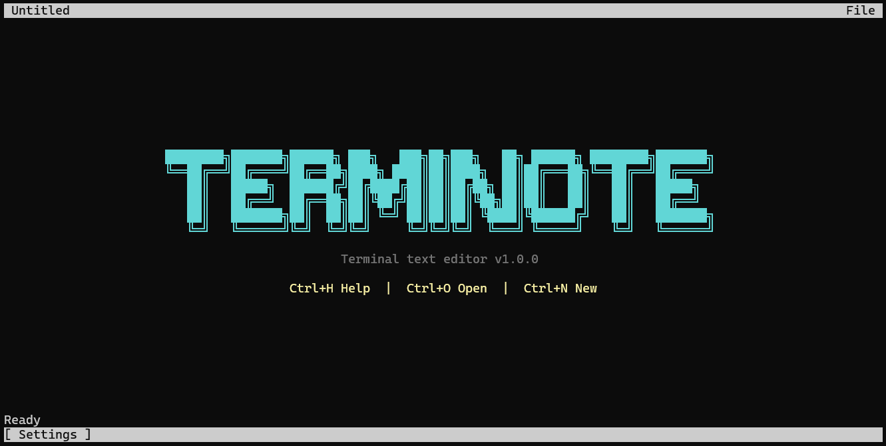
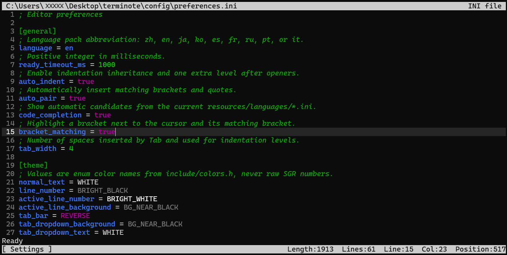

# Terminote

**A small Windows console editor with a surprisingly complete editing
workflow.**

Terminote is a nano-inspired UTF-8 text editor written in C11 specifically for
the Windows console. It talks directly to the native Windows Console API—no
ncurses compatibility layer—and its optimized Release executable is currently
only **121,344 bytes (about 119 KiB)**.



*The generated welcome banner, localized shortcuts, status area, and settings entry in the native Windows console.*

## Why Terminote stands out

- **Native and lightweight.** Direct `ReadConsoleInputA`/`WriteConsoleA`
  integration provides keyboard, mouse, resize, clipboard, and fast full-frame
  rendering without a Unix terminal dependency.
- **Small without being bare-bones.** Multiple tabs, syntax highlighting,
  completion, search and replace, mouse editing, bracket pairing, and grouped
  undo/redo are all included in the compact executable.
- **UTF-8 from input to disk.** Cursor movement, deletion, selection, display
  width, file loading, and saving all operate on UTF-8 text.
- **Configuration changes are safe.** Editing project-local INI settings can
  trigger an automatic restart that preserves open, new, and modified tabs
  through recovery copies and a startup-ready handshake.
- **Deeply configurable.** Key bindings, themes, localization, syntax keyword
  groups, indentation behavior, pairing, completion, and per-extension run
  commands are data-driven rather than hard-coded.
- **Distinctive but maintainable.** The welcome banner is generated from
  editable per-letter font files, and even renaming the executable updates the
  displayed product name and banner automatically.



*The editor view with line numbers, syntax highlighting, active-line emphasis, file statistics, and the configurable status bar.*

## Feature highlights

- Native Windows console input and rendering through `ReadConsoleInputA` and
  `WriteConsoleA`.
- Multiple file tabs, including numbered untitled buffers and modified-state
  indicators.
- Open and Save As dialogs backed by the Windows common-dialog API.
- UTF-8-aware cursor movement, deletion, selection, and file storage.
- Configurable syntax highlighting for C, C++, Go, INI, Java, JavaScript,
  Python, and Rust.
- Keyword-based completion derived from the active language definition.
- Automatic indentation, configurable space-based tabs, bracket and quote
  pairing, paired deletion, and matching-bracket highlighting.
- Incremental find and interactive find-and-replace with per-match decisions.
- Keyboard and four-direction mouse selection, clipboard operations, wheel
  scrolling, draggable scrollbars, and atomic selection drag-and-move.
- Continuous-typing undo groups plus atomic undo for paste, selection edits,
  replacement, indentation, completion, and drag-and-move operations.
- Configurable execution commands selected by file extension.
- English, Simplified Chinese, Japanese, Korean, Spanish, French, Russian,
  Portuguese, and Italian interfaces.
- Fully configurable named ANSI theme colors.
- Localized diagnostics, optional colorized verbose output, and runtime logs.
- Safe automatic restart after saving project-local INI configuration files,
  with all open tabs preserved as recovery copies.

## Quick start

Build the editor from a MinGW-compatible terminal:

```cmd
make
```

Open one or more files:

```cmd
terminote notes.txt
terminote main.c include\editor.h
```

Start with an empty untitled buffer:

```cmd
terminote
```

Terminote resolves its configuration and resource files relative to
`terminote.exe`, not the current working directory. The executable can
therefore be launched from another folder without losing its settings.
If the executable is renamed, the CLI prefixes, help screen, logs, native file
dialogs, and generated welcome banner automatically use the new base filename.
Lowercase, title-case, and uppercase contexts retain their original casing.
The complete `ascii-banner-c` font and renderer are integrated into
`src/ascii_banner.c`; the welcome artwork uses its native unboxed rendering
path rather than a separate simplified glyph set. The root Makefile is the
only build system. At build time it scans `resources/fonts/` and generates the
font index under `build/generated/`. The directory accepts only `A.inc` through
`Z.inc`; each file is left-aligned plain text containing six UTF-8 pattern rows.
Common blank edge columns are removed before adjacent glyphs are joined.

All editor INI loaders share the lightweight `ini_config` parser. It retains
ordered entries and source line numbers while preserving literal theme values
such as `#`, `;`, quotes, and backslashes.

## Command-line interface

```cmd
terminote [options] [files...]
```

| Option                | Purpose                                                                                            |
| --------------------- | -------------------------------------------------------------------------------------------------- |
| `--config [name]`   | Open a configuration file in the editor. Without a name, Terminote displays an interactive picker. |
| `--clean`           | Delete generated`.log` files and exit.                                                           |
| `--help`, `-h`    | Display localized command-line help and exit.                                                      |
| `--verbose`, `-v` | Print complete colorized startup and validation diagnostics.                                       |
| `--version`, `-V` | Print the version and exit.                                                                        |

Configuration names omit the `.ini` suffix. Programming-language definitions
retain the stable public `lang=` prefix:

```cmd
terminote --config preferences
terminote --config key-bindings
terminote --config execution
terminote --config lang=c
```

## Default key bindings

All bindings are loaded from `config/key-bindings.ini`; there are no compiled-in
fallback shortcuts. Saving this project-local INI file in Terminote triggers a
safe automatic restart.

| Action              | Default binding | Action           | Default binding  |
| ------------------- | --------------- | ---------------- | ---------------- |
| Save                | `Ctrl+S`      | Save As          | `Ctrl+Shift+S` |
| Open                | `Ctrl+O`      | New file         | `Ctrl+N`       |
| Next tab            | `Ctrl+Space`  | Run file         | `Ctrl+E`       |
| Settings            | `Alt+S`       | Help             | `Ctrl+H`       |
| Find                | `Ctrl+F`      | Find and replace | `Ctrl+R`       |
| Undo                | `Ctrl+Z`      | Redo             | `Ctrl+Shift+Z` |
| Cut                 | `Ctrl+X`      | Copy             | `Ctrl+C`       |
| Paste               | `Ctrl+V`      | Select all       | `Ctrl+A`       |
| Indent              | `Tab`         | Unindent         | `Shift+Tab`    |
| Quit without saving | `Ctrl+Q`      | Cancel           | `Escape`       |

Arrow keys, Home, End, Page Up, Page Down, Backspace, Delete, and Enter are
also configured as semantic actions in the same file. The configuration loader
rejects unknown actions, invalid modifier order, duplicate actions, conflicting
key combinations, and missing required bindings.

## Preferences and themes

`config/preferences.ini` contains general editor behavior and theme colors.

The `[general]` section controls:

- `language`: UI language abbreviation (`en`, `zh`, `ja`, `ko`, `es`, `fr`,
  `ru`, `pt`, or `it`).
- `ready_timeout_ms`: delay before the status event returns to the localized
  ready message.
- `auto_indent`: inherit indentation and add a level after supported openers.
- `auto_pair`: insert matching brackets and quotes.
- `code_completion`: show candidates from the current language definition.
- `bracket_matching`: highlight a bracket beside the cursor and its partner.
- `tab_width`: spaces inserted by Tab and the display width of tab characters.

The `[theme]` section assigns named ANSI colors to editor slots such as text,
line numbers, tabs, status bars, settings menus, completion popups, help text,
scrollbars, selections, matches, and syntax categories. Raw SGR numbers are not
accepted; values must use the enum-style names documented in
`include/colors.h`.

Preferences are validated strictly before raw terminal mode starts. Unknown
sections, duplicate keys, invalid booleans, unsupported colors, and incomplete
themes terminate startup with a localized diagnostic.

### Safe configuration restart

Saving an `.ini` file anywhere under the directory containing `terminote.exe`
automatically restarts the editor so project configuration changes take effect.
INI files outside that project tree do not trigger a restart.

Before launching the replacement process, Terminote writes every open tab
directly into the `temp/` directory beside `terminote.exe`. The single
`temp/session.txt` records the tab order, active tab, original path, backup
path, dirty counter, and one of three states for every tab:

- `new`: an unnamed tab or a path opened from the CLI that does not yet exist.
- `saved`: an existing file with no unsaved editor changes.
- `modified`: an existing file whose unsaved contents are stored in its backup.

The replacement process reads content from the backups but restores every
tab's original path and dirty state, including a null path for unnamed tabs.
The interface therefore looks like the editor merely refreshed its settings;
temporary paths are never shown as document paths, and Save writes to that
displayed original path. The new process confirms successful configuration
validation and session restoration before the old editor exits.

If configuration validation or replacement startup fails, `temp/session.txt`
and its backup files remain. The next normal editor startup restores that
session automatically after startup configuration has validated successfully.
Intermediate automatic-restart exits preserve `temp/`. When the recovered
editor is finally closed normally, every file and subdirectory inside `temp/`
is deleted and the `temp/` directory itself is removed. Both the configured
Ctrl+Q quit action and the console window's close button perform this cleanup;
ordinary sessions that did not restore a restart snapshot never manage
`temp/`.

## Syntax highlighting and completion

Language definitions live in `resources/languages/`. Terminote locates the
definition matching the active filename extension and loads only that file.
Unknown, missing, or extensionless filenames remain unhighlighted.

Each definition is an INI file with three concepts:

```ini
[language]
extensions = c,h
line_comment = //
block_comment_start = /*
block_comment_end = */

[colors]
comment = GREEN
string = BRIGHT_RED
number = BRIGHT_GREEN
variable = BRIGHT_BLUE
function = BRIGHT_BLUE

[keywords.control_flow]
color = BRIGHT_MAGENTA
words = break,continue,else,for,if,return,while
```

Any number of `[keywords.<category>]` sections may be added. Their word lists
provide both highlighting rules and completion candidates. Keywords cannot be
duplicated across categories. INI-like formats may additionally define
`section_start`, `section_end`, and a section color for highlighted headers.

To add a language:

1. Create `resources/languages/<name>.ini`.
2. Define at least one extension, a line-comment marker, all required syntax
   colors, and one keyword group.
3. Ensure its extensions do not conflict with another language file.
4. Optionally add an execution command for each extension.
5. Save the file; Terminote restarts automatically when the definition is
   inside the project directory.

## Running source files

`config/execution.ini` maps filename extensions to shell commands. The default
configuration includes C, C++, Python, JavaScript, Go, Rust, and Java examples.

Commands may use these placeholders:

| Placeholder            | Expanded value                            |
| ---------------------- | ----------------------------------------- |
| `{file_dir}`         | Directory containing the current file.    |
| `{file_path}`        | Absolute path to the current file.        |
| `{file_stem}`        | Absolute file path without its extension. |
| `{file_name}`        | Filename including the extension.         |
| `{file_name_no_ext}` | Filename without the extension.           |
| `{file_ext}`         | Extension without the leading dot.        |

Terminote requires the current buffer to have a filename and a configured
extension before it can run. Save the file first when working in an untitled
tab. Commands execute in a separate Windows command process so compiler or
program output remains available independently of the editor screen.

## Localization

UI language packs live in `resources/localization/<abbreviation>.ini` and are
divided into module sections such as `[cli]`, `[editor]`, `[help]`, `[log]`, and
`[diagnostics]`.

English is the reference key set. Every other language pack must provide the
same complete collection of keys and compatible `printf` placeholders; startup
fails rather than silently presenting a partially translated interface. The
selected language applies consistently to the CLI, editor bars, help screen,
settings UI, diagnostics, verbose output, and log messages.

Change `language` in `config/preferences.ini` and save it to select a different
pack; Terminote performs the safe automatic restart.

## Editing model

### Tabs and document state

Each tab owns its rows, filename, dirty state, viewport, cursor, selection, and
undo/redo stacks. Switching tabs saves the current document state and restores
the destination state without sharing history between files.

Files are read as UTF-8 text. `CRLF` input is normalized while reading, and
saves are serialized with Windows `CRLF` line endings.

### Undo and redo

Ordinary consecutive typing is assigned a shared undo group until a semantic
action ends the sequence. Shift-modified characters such as `+` remain in the
same group, so typing `xxx+yyy` is undone and redone as one operation.

Operations that affect a region use atomic records. This includes clipboard
paste, terminal-expanded paste, selection deletion, multi-line indentation,
completion insertion, find-and-replace, automatic pairs, and selection
drag-and-move. Atomic records transfer intact between the undo and redo stacks.
Pasted text is inserted literally: brackets, quotes, and all other characters
never trigger automatic pairing or other typing-only transformations.

### Mouse interaction

The input layer handles click, drag, release, hover, wheel, and resize records
from the console. Mouse selection works in every direction and auto-scrolls at
viewport edges. Selected text can be moved by dragging it to a new location;
the delete and insert are recorded as one transaction.

## Implementation overview

Terminote deliberately avoids a terminal abstraction library. Raw console
input, alternate-screen setup, UTF-8 code pages, mouse events, resize events,
and frame output are implemented directly with Win32 APIs.

The main rendering cycle is:

1. Update scrolling offsets so the cursor remains visible.
2. Build an append buffer containing the entire visible frame.
3. Render tabs, text rows, syntax colors, selection state, line numbers, and
   scrollbars.
4. Draw the localized event and status bars.
5. Position the hardware cursor.
6. Submit the frame in one `WriteConsoleA` call.

This single-buffer approach reduces visible tearing and keeps rendering logic
independent from individual console writes.

Key modules include:

| Module                                    | Responsibility                                                        |
| ----------------------------------------- | --------------------------------------------------------------------- |
| `terminal.c`                            | Console mode, alternate screen, code pages, and restoration.          |
| `terminal_input.c`                      | Keyboard, synthetic paste, mouse, resize, and pending input decoding. |
| `row.c`                                 | Row storage, tab expansion, syntax updates, and character boundaries. |
| `output.c` / `screen.c`               | Text rendering, scrollbars, tabs, and status/event bars.              |
| `edit.c` / `select.c`                 | Character edits, indentation, pairing, selection, and clipboard cuts. |
| `undo.c` / `redo.c`                   | Grouped and atomic transaction histories.                             |
| `syntax.c` / `completion.c`           | Lazy language loading, highlighting, and candidates.                  |
| `find.c` / `search.c` / `replace.c` | Incremental search and interactive replacement.                       |
| `tabs.c`                                | Per-document state ownership and tab switching.                       |
| `preferences.c` / `keybindings.c`     | Strict configuration validation.                                      |
| `localization.c`                        | Language-pack loading and key coverage validation.                    |
| `paths.c`                               | Executable-relative runtime path resolution.                          |

Global editor state is stored in `struct editorConfig E`. Undo and redo stacks
are also global for the active document, while `tabs.c` transfers those values
into and out of each tab's stored document state.

## Build and test

### Requirements

- Windows
- MinGW GCC with C11 support
- GNU Make (`make` or `mingw32-make`)

### Targets

```cmd
make          REM Incremental Debug build with symbols
make test     REM Unit tests plus localized startup smoke test
make release  REM Clean optimized build
make rebuild  REM Clean and rebuild Debug
make clean    REM Remove build/ and terminote.exe
```

The build enables `-Wall -Wextra`, UTF-8 source and execution character sets,
and automatic header dependency files through `-MMD -MP`. Debug and Release
objects are isolated under `build/debug/` and `build/release/`.

The current test suite checks core UTF-8 helpers, cursor boundaries, separator
classification, continuous typing groups, grouped undo/redo behavior, equal
ASCII-banner row widths, and a localized command-line startup path.

## Project layout

```text
terminote/
├── config/                  User-editable preferences, bindings, and commands
├── docs/                    Project reports and design documents
├── include/                 Public and internal C headers
├── licenses/                Retained third-party license texts
├── logs/                    Generated runtime logs
├── resources/
│   ├── fonts/               Integrated ASCII-banner font data
│   ├── languages/           Syntax and completion definitions
│   └── localization/        CLI, editor, log, and diagnostic translations
├── src/                     Editor implementation modules
├── temp/                    Generated restart recovery files (ignored)
├── tests/                   Automated C tests
├── .gitignore
├── AGENTS.md
├── Makefile
└── README.md
```

Generated `.o`, `.d`, `.exe`, and `.log` files are excluded from version
control. The root `terminote.exe` is produced by the build and remains beside
the runtime directories expected by executable-relative path resolution.

## Platform notes

- Terminote targets Windows and depends on `windows.h` and `conio.h`.
- The console input and output code pages are set to UTF-8 (`65001`).
- Clipboard integration currently uses the Win32 `CF_TEXT` format.
- The executable links against `gdi32` and `comdlg32`.
- Configuration and resource changes are loaded at startup; restart the editor
  after editing them.
